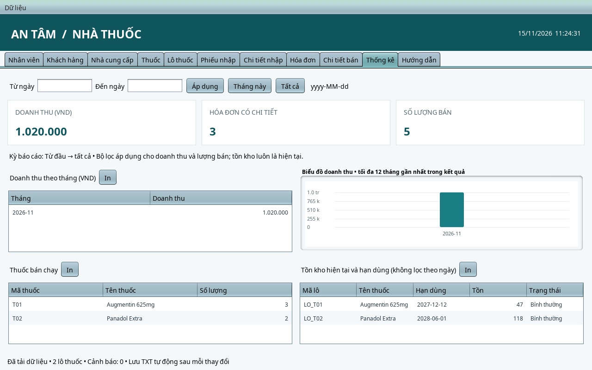
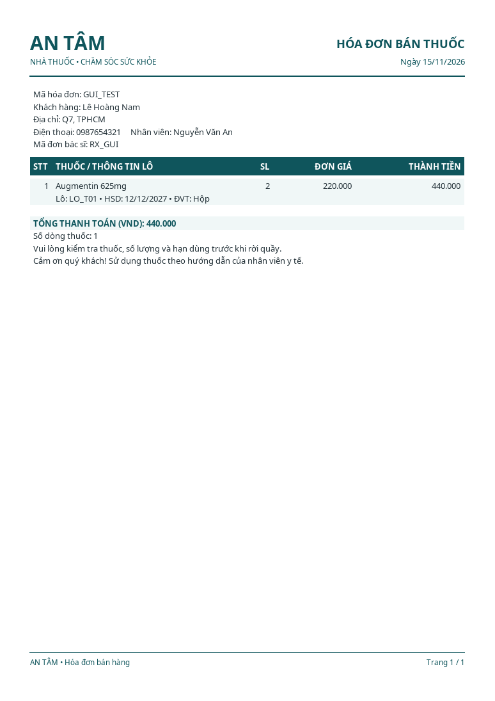

# AN TÂM — Quản lý cửa hàng bán thuốc

Đồ án Java Swing, kiến trúc **GUI → BUS → DAO**, lưu dữ liệu **TXT** theo sự cho phép của giảng viên. Không còn phân loại khách hàng VIP/thường hoặc nhân viên dược sĩ/thu ngân.

## Chạy ứng dụng

Cài **JDK 17 trở lên** (không chỉ JRE). Kiểm tra `java -version` và `javac -version`.

- Windows: nhấp `run.bat`.
- Linux/macOS: `bash run.sh`.
- Chạy ngay bản đã biên dịch: đứng trong thư mục dự án, `java -jar dist/quanlytiemthuoc.jar`.
- Kiểm thử: `bash build.sh test` (Windows: dùng Git Bash hoặc chạy các lệnh javac/java tương ứng trong build.sh).
- IntelliJ IDEA: mở thư mục dự án, chọn JDK 17+, đánh dấu `src/main/java` là Sources Root, chạy `vn.pharmacy.Main`, working directory là gốc dự án.
- NetBeans/Eclipse: tạo Java project từ sources hiện có; chọn main class `vn.pharmacy.Main` và working directory gốc dự án.

Không cần MySQL, Maven, thư viện ngoài hay mạng để chạy. Build tạo `build/pharmacy.jar`. Dữ liệu mặc định ở `data/store.txt`; có thể chọn thư mục khác bằng `java -Dpharmacy.data=/duong/dan/data -jar build/pharmacy.jar`.

## Chức năng

| Yêu cầu | Phần thực hiện |
|---|---|
| Mô hình quan hệ | 9 bảng, PK/FK, ràng buộc và ERD tại `docs/` |
| 3 lớp | `gui` chỉ gọi `bus`; `bus` xử lý nghiệp vụ, gọi `dao`; `dto` có mô tả bảng và DTO riêng cho lookup, dòng hóa đơn, hóa đơn, KPI |
| Xem/thêm/sửa/xóa/tìm | Đủ trên 9 tab dữ liệu; tìm theo tất cả cột, không phân biệt hoa thường |
| Control và form | Menu, tab, đồng hồ, giỏ hàng, combobox cho tất cả mã liên kết, gợi ý mã/giá, spinner số lượng |
| Thống kê | 3 bảng: doanh thu tháng; thuốc bán chạy; tồn kho và hạn dùng. Lọc ngày, KPI và biểu đồ doanh thu |
| Report | In danh sách/báo cáo; hóa đơn A4 có xem trước từng trang, tự phân trang và tổng tiền |
| Excel | Nhập/xuất `.xlsx` thực; 9 sheet, kiểm tra dữ liệu trước khi thay thế toàn bộ |
| Sáng tạo | FEFO gợi ý lô gần hết hạn, cảnh báo tồn thấp, giỏ hàng nguyên tử, kiểm tra tồn kho cả khi sửa lùi ngày |

## Quy trình dùng nhanh

1. Dữ liệu khởi tạo đã chuyển từ 3 file bạn cung cấp, có thêm phiếu mẫu. Đây là dữ liệu minh họa.
2. Khai báo nhân viên, khách hàng, nhà cung cấp, thuốc; sau đó khai báo lô (một thuốc có nhiều lô).
3. Nhập hàng: tạo **Phiếu nhập**, sau đó **Chi tiết nhập** (mã phiếu và mã lô đã có).
4. Bán hàng: tab **Hóa đơn → Bán hàng nhanh** → chọn KH/NV → chọn lô, số lượng, đơn giá → Thêm lô → OK. Với thuốc kê đơn phải điền mã đơn bác sĩ.
5. Chọn hóa đơn vừa lưu → **Xem / In hóa đơn** để xem trước, chuyển trang và in. Nếu hệ điều hành có máy in PDF, chọn nó để lưu PDF.
6. Có thể sửa/xóa chứng từ và chi tiết trên các tab tương ứng. Xóa chi tiết trước rồi mới xóa chứng từ cha. BUS chặn thao tác làm tồn kho âm hoặc đứt liên kết.
7. Xem tab **Thống kê**, nhập từ/đến ngày hoặc chọn **Tháng này / Tất cả** rồi in báo cáo. Tồn kho luôn là hiện tại, không bị bộ lọc ngày làm thay đổi.

Ngày nhập dạng `yyyy-MM-dd`. Tiền VND, dùng dấu chấm cho phần thập phân, không chèn dấu phân cách hàng nghìn. Giới tính: `Nam`, `Nữ`, `Khác`. Trong form chọn loại kê đơn từ danh sách; TXT/Excel lưu cờ `true` hoặc `false`. Mã dùng chữ không dấu/số/gạch dưới/gạch ngang; khi sửa không đổi khóa chính.

## Excel và TXT

Xuất Excel để lấy mẫu; giữ nguyên **9 tên sheet** và hàng tiêu đề. File xuất có tiêu đề màu, filter, cố định hàng đầu và định dạng Text. Điện thoại phải để **Text** để giữ số 0. Ngày nhận văn bản `yyyy-MM-dd` hoặc ô Excel có định dạng Date (hệ 1900/1904, không có phần giờ); cờ kê đơn nhận `true`/`false` hoặc ô Boolean. Không dùng công thức hoặc ô gộp. Nhập Excel là **thay thế toàn bộ snapshot**, không cộng dồn; ứng dụng hỏi xác nhận. Nên xuất sao lưu trước khi nhập. File sai bị từ chối toàn bộ, dữ liệu cũ vẫn giữ nguyên. Hỗ trợ chuỗi inline và shared strings thường gặp trong Excel/LibreOffice; không xử lý `.xls`, macro hoặc workbook tùy ý. Giới hạn 20 MB/file, 8 MB/XML, 10.000 dòng/sheet.

TXT sử dụng định dạng có version, mỗi dòng gồm tên bảng và các trường mã hóa Base64, cách nhau bằng TAB. Base64 chỉ là cách tránh xung đột dấu phân cách, **không phải mã hóa bảo mật**. Mở file bằng trình soạn thảo được, nhưng nên sửa dữ liệu bằng ứng dụng/Excel. DAO ghi một snapshot qua file tạm rồi đổi tên nguyên tử; file lock ngăn hai phiên cùng ghi. Thư mục lưu phải nằm trên filesystem hỗ trợ atomic move; nếu không hỗ trợ, thao tác bị báo lỗi thay vì ghi dở.

## Kiểm thử và bản hoàn thiện

`bash build.sh test` chạy **121 kiểm tra**: 63 nghiệp vụ, 24 DAO/Excel, 12 form, 5 hiển thị/sắp xếp, 17 mẫu in. Kiểm thử giao diện riêng thực hiện thêm/sửa/xóa khách hàng, nhập lượng không hợp lệ, bán hàng, kiểm tra TXT, lọc thống kê và tạo ảnh bản in. Chi tiết và các giới hạn kiểm chứng ở `docs/KIEM_THU.md`.

Chứng từ không được có ngày tương lai; không nhập/bán lô đã hết hạn tại ngày chứng từ; không đổi thuốc của lô đã có chi tiết giao dịch. Tất cả thay đổi/import vẫn phải giữ FK và tồn không âm theo ngày.

## Tài liệu đồ án

- [Thiết kế quan hệ, 3NF, ERD và ánh xạ TXT](docs/THIET_KE.md)
- [Sơ đồ ERD SVG](docs/erd.svg)
- [DDL SQL tham khảo](docs/schema.sql) — tài liệu mô hình, ứng dụng thực tế dùng TXT.
- [Thiết kế form và kiến trúc 3 lớp](docs/KIEN_TRUC.md)
- [Kịch bản demo và đối chiếu tiêu chí](docs/BAO_VE.md)
- [Kiểm thử và giới hạn](docs/KIEM_THU.md)

Cần trình giảng viên duyệt mô hình quan hệ trước khi nộp đúng quy trình đã nêu. Việc giảng viên cho lưu TXT không tự thay thế bước duyệt thiết kế; điểm số do giảng viên quyết định.

## Giao diện minh họa

Ảnh được tạo từ kiểm thử bán hàng trên bản sao dữ liệu; không sửa dữ liệu mẫu gốc.

