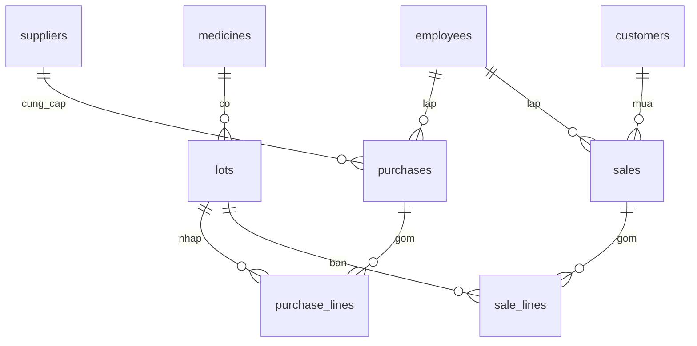

# Thiết kế CSDL quan hệ

## Phạm vi và giả định

Quản lý một cửa hàng, một kho; mỗi thuốc có một đơn vị chuẩn. Nhập và bán cùng đơn vị. Một thuốc có nhiều lô, mỗi lô một hạn dùng. Một phiếu nhập mua từ một NCC và một nhân viên phụ trách; hóa đơn gắn một khách hàng và một nhân viên. Khách lẻ cần tạo một bản ghi khách hàng trước. Không có nhóm VIP/thường, dược sĩ/thu ngân. Giữ cờ kê đơn trên thuốc.

Mã đơn bác sĩ là thông tin tham chiếu nhập tay, không xác thực với cơ sở y tế. Không có module kê đơn. Không xử lý bảo hiểm, thuế, giảm giá, trả hàng, công nợ, nhiều cửa hàng hoặc quy đổi hộp/vỉ/viên.

Tồn đầu là số dư tại thời điểm bắt đầu quản lý. Tồn hiện tại = tồn đầu + tổng nhập − tổng bán, không lưu một cột tồn dư thừa. Kiểm tra tồn ở từng ngày chứng từ; nhập cùng ngày được xét trước xuất. Ngày phiếu nhập/hóa đơn được phép trong quá khứ hoặc hôm nay, không được trong tương lai; vì vậy số tồn hiện tại không bao gồm giao dịch chưa đến ngày. Sửa/xóa vẫn phải giữ tồn không âm ở mọi mốc. Không nhập hoặc bán lô vào ngày đã hết hạn (kể cả đúng ngày ghi trên lô). Cảnh báo sắp hết hạn trong 90 ngày; tồn thấp dưới 10 đơn vị.

## Lược đồ

| Bảng TXT/Excel | Khóa chính | Thuộc tính còn lại | Khóa ngoại |
|---|---|---|---|
| employees | employee_id | name, address, gender, birth_date, phone, hired_date, email, salary | — |
| customers | customer_id | name, address, gender, birth_date, phone | — |
| suppliers | supplier_id | name, address, phone | — |
| medicines | medicine_id | name, unit, selling_price, prescription_required, ingredient_or_use, instructions | — |
| lots | lot_id | medicine_id, expiry_date, opening_stock | medicine_id → medicines |
| purchases | purchase_id | purchase_date, supplier_id, employee_id | supplier_id → suppliers; employee_id → employees |
| purchase_lines | line_id | purchase_id, lot_id, quantity, unit_price | purchase_id → purchases; lot_id → lots |
| sales | sale_id | sale_date, customer_id, employee_id, prescription_ref | customer_id → customers; employee_id → employees |
| sale_lines | line_id | sale_id, lot_id, quantity, unit_price | sale_id → sales; lot_id → lots |

Chi tiết nhập có UNIQUE(purchase_id, lot_id). Chi tiết bán có UNIQUE(sale_id, lot_id). Đơn giá nhập/bán lưu tại dòng chứng từ, giữ lịch sử khi thay đổi giá danh mục. Không lưu tổng hóa đơn hay doanh thu khách hàng vì đều tính được từ chi tiết bán. Địa chỉ là chuỗi đơn giản trong phạm vi một cửa hàng.

## Quan hệ và chuẩn hóa

Mô hình được thiết kế theo 3NF trong phạm vi các phụ thuộc nghiệp vụ đã nêu: mỗi ô chứa một giá trị; bảng danh mục có khóa chính đơn; hai bảng chi tiết có thêm khóa ứng viên cặp chứng từ–lô. Số lượng và đơn giá phụ thuộc vào cả cặp chứng từ–lô, không chỉ vào mã phiếu hay mã lô. Tên thuốc/khách hàng/nhân viên/NCC lưu tại bảng danh mục; hạn dùng lưu tại lô; chứng từ dùng khóa ngoại để tránh lặp các thuộc tính này. Đây là lập luận thiết kế theo giả định của đồ án, cần trình giảng viên duyệt; không thay thế bước duyệt mô hình của môn học.

## Ràng buộc

- Mã chính duy nhất, bắt buộc; mã tham chiếu phải tồn tại.
- Không đổi khóa chính khi sửa. Xóa cha bị từ chối nếu còn con, tương đương ON DELETE RESTRICT.
- Số lượng chi tiết là số nguyên dương; tồn đầu nguyên không âm. Tiền không âm, tối đa hai chữ số thập phân; BUS dùng BigDecimal.
- Không bán vượt tồn ở bất kỳ ngày chứng từ nào. Không nhập/bán lô hết hạn tại ngày chứng từ.
- Ngày phải hợp lệ đúng `yyyy-MM-dd`, năm từ 0001 đến 9999. Phiếu nhập và hóa đơn không ghi ngày tương lai; ngày vào làm không trước ngày sinh.
- Thuốc kê đơn cần mã đơn bác sĩ trên hóa đơn.
- Sửa dữ liệu cha (ví dụ hạn dùng hoặc cờ kê đơn) phải giữ hợp lệ các chứng từ lịch sử. Khi sửa từng bản ghi lô, không đổi mã thuốc nếu lô đã có chi tiết nhập/bán: cần tạo lô mới thay vì biến giao dịch cũ thành một thuốc khác.
- Snapshot nhập từ Excel phải đủ chính xác 9 bảng, đúng số cột, không có giá trị null hay ký tự điều khiển XML không hỗ trợ. Nhập toàn bộ snapshot là thay thế tập dữ liệu, không phải hệ thống ghi lịch sử chỉnh sửa.
- Không bắt buộc mỗi chứng từ có chi tiết ngay khi thêm qua CRUD vì quy trình lập từng bước. Bán hàng nhanh bắt buộc có chi tiết và lưu cả giỏ trong một lần.

## Lưu TXT nhưng giữ mô hình quan hệ

`data/store.txt` chứa cả 9 bảng trong một snapshot version `PHARMACY_TXT_V1`. Mỗi dòng: tên bảng TAB Base64(cột 1) TAB Base64(cột 2)... Dữ liệu sau giải mã UTF-8 có thứ tự đúng `Schema.TABLES`; Excel dùng cùng tên bảng/thứ tự cột.

Không có DBMS trong bản nộp. BUS chịu trách nhiệm kiểm tra ràng buộc cho cả snapshot trước khi DAO ghi. DAO không tự kiểm tra FK và không được gọi trực tiếp từ GUI. Một lần lưu = một snapshot hoàn chỉnh, tránh ghi hóa đơn thành công mà mất chi tiết. File lock và atomic replace hỗ trợ nhất quán trong phạm vi một máy; không phải cơ sở dữ liệu mạng nhiều người dùng.

`schema.sql` biểu diễn mô hình trên SQLite để đọc/kiểm tra PK/FK/CHECK; không phải đường lưu dữ liệu của ứng dụng. Ràng buộc tổng tồn, hết hạn, ngày chứng từ và đơn bác sĩ được kiểm tra tại BUS, không thể chỉ dựa vào các CHECK đơn bảng của DDL. Cờ kê đơn trong TXT/Excel là chuỗi `true`/`false`, trong DDL tham khảo là số 1/0; tiền trong BUS là BigDecimal, dữ liệu TXT vẫn lưu dạng văn bản thập phân.

## Dữ liệu báo cáo

Báo cáo doanh thu và thuốc bán chạy lọc theo ngày hóa đơn; khoảng ngày bao gồm cả ngày bắt đầu và ngày kết thúc. Doanh thu tính từ giá lưu ở dòng bán, không lấy giá hiện tại trong danh mục thuốc. Tổng quan kỳ gồm doanh thu, số hóa đơn có ít nhất một dòng bán và tổng lượng bán; hóa đơn mới tạo nhưng chưa có chi tiết là bản nháp, không tăng số hóa đơn bán của báo cáo.

Bảng tồn kho là trạng thái hiện tại và không chịu bộ lọc ngày doanh thu. Hóa đơn in được BUS ghép thành `InvoiceReport` và `InvoiceLine` có kiểu dữ liệu cụ thể; các đối tượng này không bổ sung bảng lưu trữ hay làm thay đổi lược đồ 9 bảng.

## Chuyển dữ liệu cũ

- `nhanvien.txt`: bỏ nhãn DUOCSI/THUNGAN, bằng cấp/phụ cấp/số ngày công; giữ nhân viên chung và lương cơ bản.
- `khachhang.txt`: bỏ nhãn VIP/THUONG, hạng thành viên/điểm và doanh thu tích lũy cũ. Không biến doanh thu cũ thành hóa đơn giả; thống kê chỉ tính từ hóa đơn mới có trong hệ thống.
- `thuoc.txt`: chuyển loại kê đơn thành cờ boolean; tách hạn dùng và số lượng sang lô `LO_T01`, `LO_T02`.
- Chuẩn hóa ngày dd/MM/yyyy → yyyy-MM-dd, giới tính 0 → Nam, 1 → Nữ (giả định từ file mẫu, cần đối chiếu với quy ước bài cũ nếu khác).
- Thêm một NCC, một phiếu nhập và hai hóa đơn minh họa, không phải dữ liệu kinh doanh thực tế.
